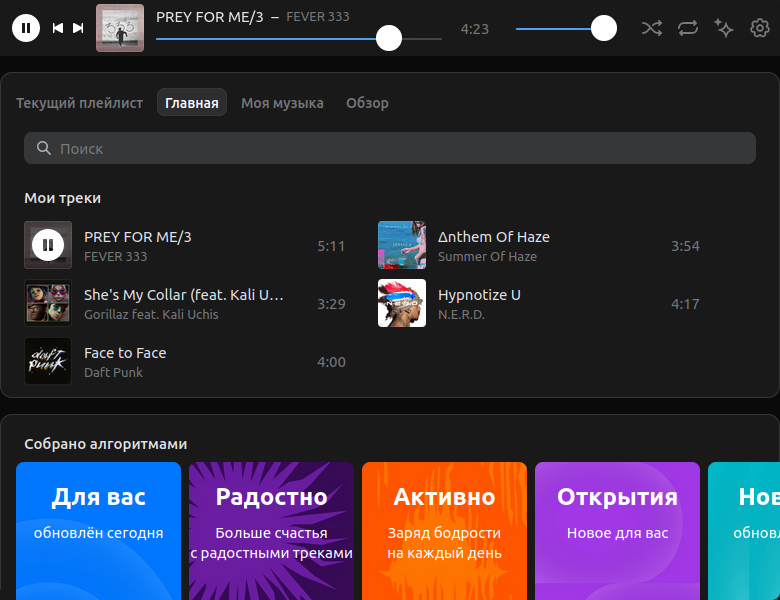
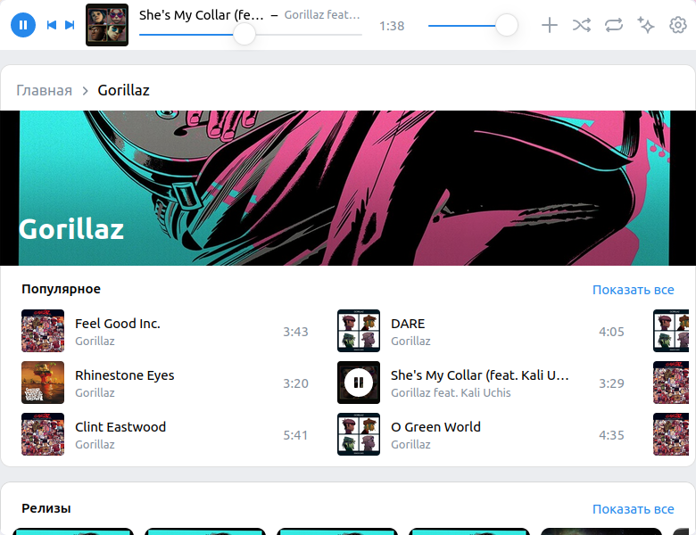

# VK Audiopad

Chrome and Firefox extension for [VK Music](https://music.vk.ru/)

|              dark               |               light               |
| :-----------------------------: | :-------------------------------: |
|  |  |

## Try it

[Chrome Web Store](https://chrome.google.com/webstore/detail/plclpmphdjmdgmdpfkcmdkmohgpfecip)  
[Add-ons for Firefox](https://addons.mozilla.org/ru/firefox/addon/vkaudiopad/)  
[~~Opera Addons~~](https://addons.opera.com/ru/extensions/details/vk-audiopad/)

## Development

Use Node from [.node-version](./.node-version) and the npm version in `packageManager` in [package.json](./package.json). CI and Docker use these same pins. Newer Node patch/minor versions within the same major are supported; use the exact reference version when reproducing CI. Commands below target macOS/Linux (or a Linux environment on Windows).

```bash
# After selecting Node with your version manager:
npm install --global npm@11.19.1
node scripts/doctor.mjs --runtime-only
npm ci
npm run check
npm test
./build.sh
npm run verify:build
```

Run all commands from the repository root. `npm ci` installs the committed lockfile; use `npm install` only when intentionally changing dependencies. `npm run doctor` checks runtime versions, workspace links and scripts, installed tools, direct workspace dependencies and all shared MCP settings. It runs automatically as part of `check`.

`npm test` runs offline tests for common, extension contexts, React state and tooling. Tests can run immediately after `npm ci`, before building common. Unexpected fetch calls fail the suite. `npm run check` includes test typechecking, tooling lint and `docs:check` for local documentation references/commands; see [test harness instructions](./docs/ai/testing.md#automated-tests-without-vk).

`npm run smoke:firefox` runs an isolated headless Firefox runtime probe after the full build, without VK login. CI runs the same command; authenticated music and actual-popup checks remain separate. See [Firefox testing](./docs/ai/testing.md#firefox-smoke-through-mcp).

The extension is built into `dist/chrome_extension` and `dist/firefox_extension`. In Chrome, open `chrome://extensions`, enable Developer mode and load the unpacked Chrome directory. In Firefox, open `about:debugging`, choose This Firefox and load the Firefox manifest as a temporary add-on. Live VK checks require an authenticated VK session; see [testing instructions](./docs/ai/testing.md).

`./build.sh front` rebuilds common and the popup after a full build; `offscreen` and `service-worker` work the same way. Other package outputs are reused. Use a full build after cross-package changes. Build `common` first when invoking workspace commands manually; `check` and every `build.sh` invocation do this automatically.

## Release packaging

`./to-publish.sh` builds with Docker and produces ZIP files in `dist`. The container reads the Node pin and bootstraps the pinned npm if needed. This script currently cleans local build artifacts and dependencies; isolated release packaging is planned in [T16](./docs/ai/development-roadmap.md#t16-build-a-release-from-one-verified-revision). Use `./build.sh` for normal development.

## Architectural methodology

Project based on [Feature-Sliced Design](https://feature-sliced.design/)

## AI-assisted development

New contributors and agents: start with [the project guide](./docs/README.md) and [contributing instructions](./CONTRIBUTING.md). They link product scenarios, state ownership, change routes and verification evidence. Project-authored documentation and agent instructions are maintained in English only; actual Russian UI labels remain in examples where needed.

Instructions for AI agents: [AGENTS.md](./AGENTS.md), architecture details: [docs/ai/architecture.md](./docs/ai/architecture.md). Claude Code imports the same instructions through `CLAUDE.md`.

MCP servers (VKUI docs, Chrome and Firefox extension debugging) have one source: [`.mcp.json`](./.mcp.json), read directly by Claude Code. The committed [`.codex/config.toml`](./.codex/config.toml) and `mcp` section in [`opencode.json`](./opencode.json) are generated for Codex and OpenCode 1.x. After changing the source, run `npm run mcp:sync`; `npm run mcp:check`, doctor and CI reject configuration drift. Open the repository root, trust the project in Codex, approve project servers if Claude Code asks, and restart the client after config changes. See [MCP setup and maintenance](./docs/ai/mcp.md) for commands and supported formats.

Check the actual connection in your agent session. Without VKUI MCP, use the installed `@vkontakte/vkui` type declarations and existing components as API references; a missing MCP connection does not block local checks.

Development workflow: [docs/ai/agent-workflow.md](./docs/ai/agent-workflow.md). Readiness review and implementation plan: [review](./docs/ai/readiness-review.md), [roadmap](./docs/ai/development-roadmap.md).
