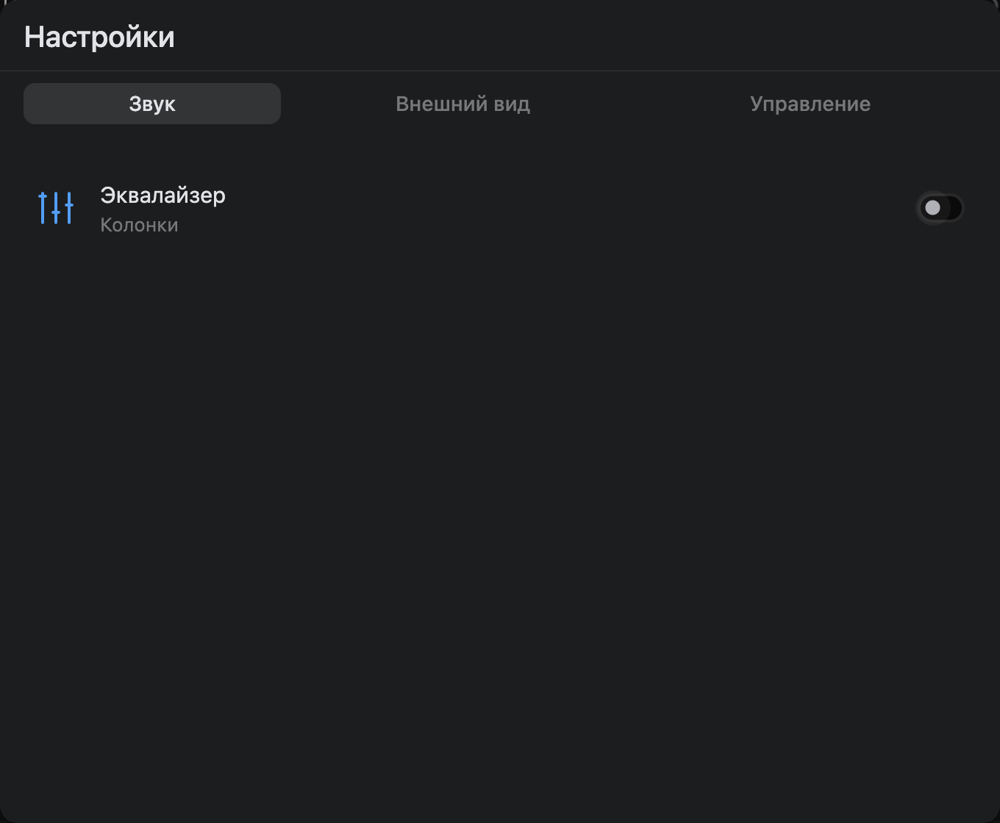
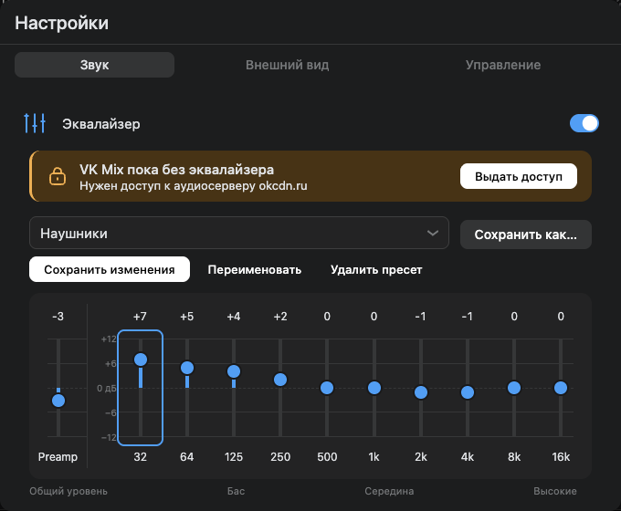
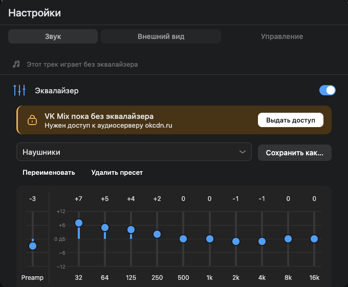

# Equalizer interaction and visual design

Research date: November 6, 2026; ten-band and validation follow-ups: November 7, 2026. This is a product decision for VK Audiopad's 780×600 popup, not a claim that one equalizer layout is an industry standard in 2026.

## Current reference patterns

| Product / primary source | Documented interaction | Relevance to Audiopad |
|---|---|---|
| [Spotify Equalizer](https://support.spotify.com/us/article/equalizer/) | Playback settings contain an on/off switch, presets and draggable equalizer points. | Start with presets, retain manual adjustment and a clear bypass. Settings placement is a valid pattern, but an additional settings journey is costly in our small popup. |
| [Apple Music on Mac](https://support.apple.com/en-mo/guide/music/-museb684a3de/mac) | A separate Equalizer window contains presets, vertical frequency faders, gain in dB and an on switch. | Vertical bands share a baseline, so users can read the whole bass-to-treble shape at once. |
| [SoundSource built-in effects](https://rogueamoeba.com/support/manuals/soundsource/?page=built-in-effects) | A compact inline view offers presets; a popover reveals manual band/preamp adjustment. | Separate the compact overview from detailed band adjustment through progressive disclosure. [Official popover illustration](https://rogueamoeba.com/support/manuals/soundsource/images/audioeffects-eq-popover.png). |
| [WAI-ARIA slider pattern](https://www.w3.org/WAI/ARIA/apg/patterns/slider/) | Sliders need a name, values, orientation and keyboard operation; arrows, Home and End have defined behavior. | Each band must remain an independent keyboard-accessible control with a readable frequency and decibel value. |
| [WCAG 2.2 target size guidance](https://www.w3.org/WAI/WCAG22/Understanding/target-size-minimum.html) | Targets generally need 24×24 CSS pixels or the specified spacing exceptions; visible glyph size and hit area are distinct. | Use generous hit areas around compact icons and thin faders, plus visible keyboard focus. |

## Streaming-service follow-up

[Spotify's official illustrated FAQ](https://community.spotify.com/forum/en/kb/articles/857-equalizer-overview) shows its desktop six-point EQ curve, preset selector and reset inside Playback settings. The illustration is a guide reference, not evidence of a specific installed 2026 build. [Apple Music on Windows](https://support.apple.com/en-mo/guide/music-windows/museb684a3de/windows) documents more than twenty presets, vertical faders and saving a custom preset. [Deezer's guide](https://support.deezer.com/hc/en-gb/articles/115003861425-Deezer-Equalizer) lists Pop, Classical, Jazz, Rock and Custom, retaining the last choice; availability depends on the device. [Amazon Music's Android guide](https://digprjsurvey.amazon.co.uk/csad/help/node/TG3BNTGtuoT5YobFe9) places EQ behind the settings gear and supports genre-oriented adjustment. Those mobile/device paths are not assumed to exist in their desktop/web players.

For Audiopad, this favors a scalable preset menu, named custom curves and clear bypass while retaining the readable shared-axis faders. Persistent settings navigation addresses our popup's limited height; copying a streaming app's long settings page would obscure the other categories.

## Chosen interaction

Settings is the single entry point. The existing gear keeps the player toolbar compact. A fixed, viewport-capped frame prevents the dialog from jumping between collapsed/expanded equalizer states. Sound, Appearance and Controls are persistent tabs in the header: other settings remain visibly discoverable even when the equalizer occupies the content area. VKUI handles tab focus/selection and the tab panels expose their names and relationships. The initial tab is Sound.

Sound initially shows one equalizer row with an on/off switch and the saved curve summary. Disabling removes the detailed controls and their tab stops while retaining both the current curve and named personal presets. Enabling reveals manual detail below the row. Appearance retains the palette icon beside a compact theme field with its label directly above the control. Controls retain browser-specific shortcut guidance, a direct separate-tab link and Chrome shortcut-creation guidance. The frame stays the same size when switching tabs; only its content can scroll on shorter viewports. Each modal request gets a fresh manager ID so a dismissed instance can reopen.

A preset selector scales to twelve choices without consuming rows of buttons: Flat, More Bass, Less Bass, Brighter, Softer, Vocals, Speech, Pop, Rock, Electronic, Jazz and Classical. These are Audiopad's own ten-band starting curves, not copied vendor coefficients or guaranteed headphone correction. The selector has no visible “Пресет” heading, retaining an accessible label. Manual adjustments without a selected personal preset show “Ручная настройка”. Editing a personal preset keeps its name selected and exposes Save Changes alongside rename/delete; Save As creates a separate copy of bands and Preamp. Multiple personal presets share the selector below a “Мои пресеты” divider, support rename and confirmed deletion, and survive UI closure, extension UPDATE and settings-preserving cleanup. The old single My Preset migrates into that collection. The separate on/off switch supports comparison with the original sound.

Ten octave-spaced bands (32, 64, 125, 250, 500 Hz and 1, 2, 4, 8, 16 kHz) run from bass to treble on a shared scale marked at +12/+6/0/−6/−12 dB. A separated Preamp fader on the left adjusts all frequencies. The modal is 680 px wide in the 780 px popup so the controls remain comfortably spaced. Values and frequencies stay visible without hover. Reset restores neutral active bands and 0 dB Preamp without deleting saved presets. Actual processing feedback is distinct from the enabled setting because some sources cannot enter the processing graph. The ten-band graph supersedes the initial five-band tone control after comparison with the supplied Apple Music/SoundSource-style references. Legacy custom curves are approximately migrated in log frequency; built-ins retain their intent through named mappings.

VKUI 8's Slider exposes horizontal orientation only. A local vertical slider implements the WAI-ARIA pattern with pointer capture, a broad hit area and explicit keyboard handling for arrows, Page Up/Down, Home and End. Browser AX inspection found that rotating a native range and setting aria-orientation still reported horizontal orientation in Chrome. The dedicated semantic slider reports vertical orientation without newer vertical-range CSS or a higher minimum browser version. VKUI owns the modal, tabs, groups, cells, selector, buttons, switch and typography; theme tokens style both appearances.

The graphic shows band settings rather than a measured acoustic response. Preamp is a real shared gain stage. “Компенсация усиления” defaults off and is optional, using the combined filter response rather than summing all boosts. Preamp remains an independent manual offset. A tooltip explains the feature without a permanent calculated-level paragraph. Only preparation/unavailable-source statuses appear; obvious waiting/active status and the redundant frequency-range subtitle are removed. Spectrum animation remains outside the implemented processing chain.

## Verification

[UI regressions](../../tests/front/equalizer.test.ts) exercise presets, custom-save/recall, clamping, keyboard bounds, bypass preservation, external settings, conditional disclosure, tab navigation and closing/reopening with the saved personal curve. Live visual evidence belongs to [testing](../ai/testing.md). Processing/storage contracts and CDN limits belong to [ADR 0010](../decisions/0010-equalizer.md).

## Actual interface

The section tabs stay visible in both states. Enabling the equalizer reveals detail inside Sound; Appearance and Controls remain one tab selection away.

| Overview, effect off | Sound detail, effect on |
|---|---|
|  |  |

The earlier [light appearance checkpoint](images/settings-equalizer-light.png) illustrates the shared theme tokens; the latest editing/status follow-up is shown below.

## Optional Mix access

The first explicit EQ enable can show a dismissible explanation, following the existing VK permission-request pattern but keeping Mix access optional. It names okcdn.ru, explains audio processing and states that music and other EQ sources continue without that grant. Only the Allow action invokes the native permission request. A remembered refusal is a warning-colored restriction card immediately below the switch, above the faders, with a lock icon, explicit Mix title and primary Give access button; that button can reopen the explanation and request again. Cold startup and reopening an already-enabled EQ do not prompt. A separate VKUI card manager suspends/restores the parent settings focus trap. Chrome uses optional_host_permissions; Firefox uses optional_permissions for compatibility with the existing Firefox 113 minimum.

| Explanation before the browser request | Refusal with explicit retry |
|---|---|
|  |  |

[Appearance settings](images/settings-appearance.png) keep the theme label and selector aligned.

Current-track preparation/unavailable feedback sits in a compact strip above the Sound settings, with a music icon, a concise track-specific message and divider. The subdued styling identifies playback status without making it look like another setting. Settings hints use an anchored VKUI Popover with a close button, no focus trap, a 1.5-second appearance delay and five visible seconds of lifetime; placement prefers above the gear and flips when needed to stay within the viewport. The first-release hint is restricted to updates crossing 3.3.10, including skipped releases. The missing-access hint checks the actual CDN hostname rather than the playlist label.

| First-release discovery | Missing access for the current source |
|---|---|
|  |  |

[Current-track status](images/settings-track-status.png) is separate from the equalizer controls. These follow-up screenshots use the actual extension UI in an isolated Chromium profile with synthetic state; the earlier authenticated browser evidence is recorded separately in [testing](../ai/testing.md).

The missing-access hint now says “Эквалайзеру нужен доступ”, identifying the affected feature instead of referring vaguely to “this track”. Its server/purpose explanation and all other maintained UI helper messages omit terminal full stops. Theme selection uses a fixed 240 px field/menu so all three options fit, keeping the palette icon and aligned label. [Open theme menu](images/settings-appearance-menu.png) shows the actual dropdown. Failed-source status stays stable while trying presets; normal control edits do not initiate another denied media download.
